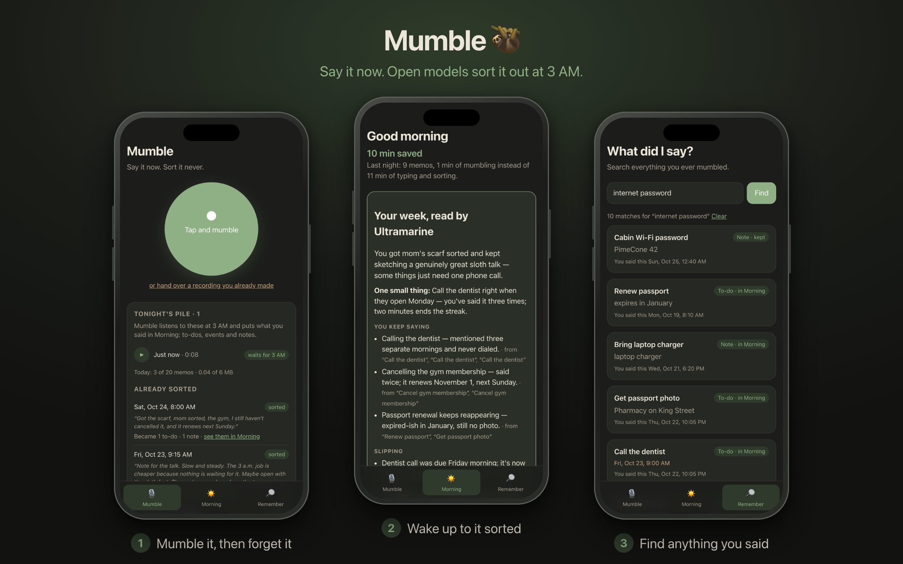
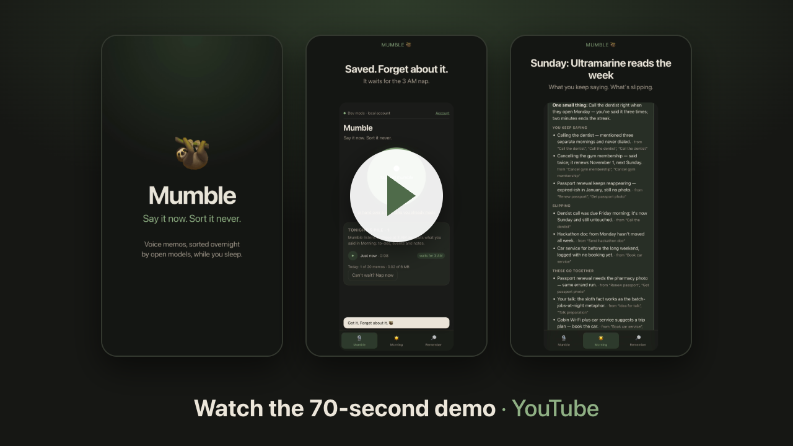
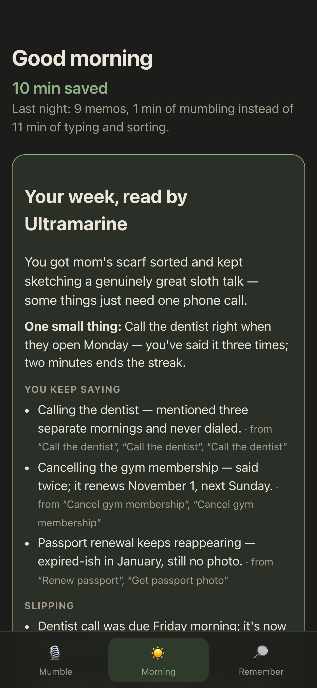

# Mumble 🦥

Mumble at your phone all day. Open models sort it out overnight.

**Live:** https://mumble-azure.vercel.app



Record rambling voice memos whenever something pops into your head. At 3 AM, a
free GitHub Actions runner wakes up, transcribes them with Whisper, and has
Gemma turn them into to-dos, calendar events and notes. In the morning you open
one screen and tap **Done**, **Keep**, **Add to calendar** or **Dismiss** (each with Undo).
Until then you can play a memo back to check it saved; kept notes and search live in **Remember**.

It costs nothing to run.

[](https://youtube.com/shorts/es16znn7-r8)

## A real morning



A demo week of everyday memos (voiced with macOS `say`): 9 memos, 70 seconds of
talking, 220 words. The nap turned them into 16 to-dos, events and notes, and
Morning opened with:

> **10 min saved.** Last night: 9 memos, 1 min of mumbling instead of 11 min of typing and sorting.

Mumble counts typing at 40 words a minute, plus about 20 seconds to file each item
into the right list with the right date.

On Sundays, Ultramarine reads the whole week. In the demo week it noticed "call the
dentist" said on three separate mornings, and never done. Every claim cites the
items it's based on. That review cost $0.0004.

<br clear="right">

## How it works

- **Open models do all the thinking:** [faster-whisper](https://github.com/SYSTRAN/faster-whisper) for speech,
  Gemma (`gemma4:e2b-it-qat`) for structure and `embeddinggemma` for memory, all served by [Ollama](https://ollama.com).
- **Gemma never does date math.** It copies the exact time phrase you said ("Tuesday at 10am");
  plain code turns that into a timestamp. A phrase you never said is thrown away.
- **Slow on purpose.** CPU only. Nobody is awake at 3 AM to wait for it.
- **Your audio doesn't stick around.** Each recording is deleted as soon as it's sorted.
- **Real sign-in, and everyone only sees their own.** Auth0 (OAuth 2 with PKCE) issues
  one-hour access tokens; the API checks signature, issuer, audience and app on every
  request, and every query is scoped to the signed-in account.
- **Quotas, so a free stack stays free.** Each account gets 20 memos and 6 MB of audio a
  day, 40 unsorted memos, 120 requests a minute, 25 memos per night's nap and one review a
  week. Sign-ups stop at 50 accounts. Delete your account and everything goes with it.
- **One thing leaves for a closed model, and only if you turn it on.** The weekly review sends
  that week's item titles and details (never audio or transcripts) to Ultramarine by
  Paper Instruments. No `PAPERINSTRUMENTS_API_KEY`, no review, and nothing leaves.

```
Phone PWA ──▶ Vercel (free static site) ◀──▶ Auth0 (sign-in, free)
    │
    └─ /api ──▶ Vercel Function (Python, free) ──▶ Postgres + pgvector (Tiger Data, free)
                                                                 ▲
          3 AM cron ──▶ GitHub Actions (free CPU runner): Ollama + Gemma + Whisper
```

| Piece | Where | Cost |
|---|---|---|
| Phone app (`web/`) | Vercel static files | free (Hobby) |
| API (`api/index.py` → `mumble/api.py`) | Vercel Function | free (Hobby) |
| 3 AM alarm | GitHub Actions schedule | free |
| Night shift (`mumble/nap.py`) | GitHub Actions, public repo | free |
| Database | Tiger Data (Postgres + pgvector) | free tier |
| Sign-in | Auth0 | free plan |

## Project layout

```
web/          the phone app (PWA): plain HTML, CSS and JS, no build step
api/index.py  Vercel's entrypoint; hands each /api request to mumble/api.py
mumble/
  core.py       the API's logic and quotas, shared by the cloud and the local server
  api.py        the cloud API (only needs psycopg and PyJWT)
  auth.py       checks Auth0 access tokens
  main.py       the local dev server (FastAPI)
  nap.py        the night shift: Whisper, then Gemma, then embeddings
  transcribe.py / structure.py   speech to text / text to to-dos, events, notes
  review.py     the Sunday review by Ultramarine
  db.py, config.py
scripts/      demo_week.py seeds a week of spoken memos; claim.py adopts pre-sign-in data
tests/
.github/workflows/nap.yml   the 3 AM schedule
vercel.json   hosting: static web/, /api rewrite, security headers
```

## Run it locally

Needs [uv](https://docs.astral.sh/uv/), [Ollama](https://ollama.com), ffmpeg and Docker.

```bash
ollama pull gemma4:e2b-it-qat && ollama pull embeddinggemma
docker compose up -d                  # local Postgres + pgvector
cp .env.example .env
uv sync --all-groups                  # the API alone needs psycopg + PyJWT; "nap" has the models
MUMBLE_DEV=1 uv run uvicorn mumble.main:app --reload
```

Open `http://localhost:8000`, record something, then tap **Can't wait? Nap now**
(or run `uv run python -m mumble.nap`). `MUMBLE_DEV=1` signs everything from this
machine in as one local account; set the `AUTH0_*` variables instead to sign in for real.

The microphone only works on `localhost` or over HTTPS. Locally, search also
matches by meaning (the query is embedded with Ollama); the serverless API
searches by keyword.

## Deploy (all free)

1. **Database.** Create a free Tiger Cloud service and copy its connection string.
   Create the tables once: `DATABASE_URL='postgres://...' uv run python -c "from mumble import db; db.init()"`
2. **Sign-in.** Create a free Auth0 tenant with a *Single Page Application* (callback, logout
   and web-origin URLs = your app's URL, refresh token rotation on) and an *API* (identifier
   `https://<your-app>/api`, RS256, token lifetime 3600 s, offline access on). Put the domain,
   client id and identifier in `web/config.js`.
3. **Night shift.** Push this repo to GitHub (public, so Actions minutes are free) and add
   the secret `DATABASE_URL` under *Settings → Secrets and variables → Actions*.
4. **App + API.** Import the repo in Vercel (*Add New → Project*, Hobby plan, no card).
   `vercel.json` already says what to do: serve `web/`, run `api/index.py` for `/api/*`.
   Add `DATABASE_URL`, `AUTH0_DOMAIN`, `AUTH0_AUDIENCE`, `AUTH0_CLIENT_ID` and
   `MUMBLE_ICS_SECRET` (32+ random characters, signs calendar links), then deploy.
   Optional: `MUMBLE_MAX_ACCOUNTS` (default 50), `MUMBLE_ALLOWED_EMAILS` (invite-only).
5. On your phone, open the app, sign in, and *Add to Home Screen*.

To give one account more room: `UPDATE accounts SET quota = '{"memos_per_day": 50}' WHERE email = '...'`.
To switch one off: `UPDATE accounts SET disabled = true WHERE email = '...'`.

## Tests

```bash
uv run pytest
```

## License

MIT
